# CineGL (iOS)

[简体中文](README.md) | English

A cinematic camera app that doubles as a study project for **Metal rendering and filters**. Camera frames run through a complete GPU pipeline (lens → film exposure → development and grading → grain), and the live preview, video recording and photos all share the same renderer.

This repository is the iOS implementation of CineGL for Android (a separate repository, `CineGL-Android`), with the same features and the same UI. It is written entirely in Objective-C; the pure math (color, LUT baking, geometry) is plain C functions plus simd, so it can be unit-tested directly. Rendering moved from OpenGL ES 3.0 to Metal, the fastest option on iOS: every shader was rewritten from GLSL to MSL, with the same passes and the same parameters.

- [UI overview](#ui-overview)
- Features: [Looks](#looks) · [Film effects](#film-effects) · [Log and LUT burn-in](#log-and-lut-burn-in) · [Manual controls](#manual-controls) · [One-tap reset](#one-tap-reset) · [Monitoring tools](#monitoring-tools) · [Aspect ratio, video and photos](#aspect-ratio-video-and-photos)
- Development: [Build and run](#build-and-run) · [Tests](#tests) · [Architecture](#architecture) · [Project layout](#project-layout)
- More: [Differences from the Android version](#differences-from-the-android-version) · [About the screenshots](#about-the-screenshots) · [Known limitations](#known-limitations) · [Further reading](#further-reading)

## UI overview

<p align="center">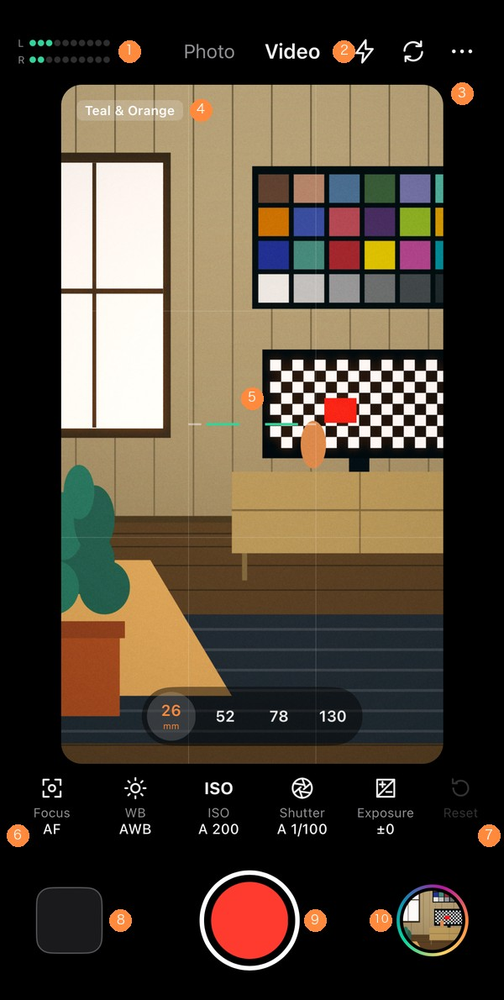</p>

| # | Name | Description |
|:---:|---|---|
| 1 | Audio meter | Left / right microphone levels in video mode |
| 2 | Photo / Video | Switches the capture mode; disabled while recording |
| 3 | Flip · Settings | Switches between the front and back cameras; `···` opens the settings panel. Devices with a torch get an extra torch button on the left |
| 4 | Status chips | The current look; with log on, also `LOG`, `LUT burned in` / `LUT monitor only` and `Log view` |
| 5 | Grid and level | Rule-of-thirds grid; the level's center line stays parallel to the horizon and turns green when level |
| 6 | Manual controls | Focus, white balance, ISO, shutter and exposure compensation. Tap one to open its dial; an orange value means that control is manual |
| 7 | One-tap reset | Lights up when any control is manual; tap it to put everything back on auto |
| 8 | Gallery | Thumbnail of the latest capture; tap to open it in the system preview |
| 9 | Shutter | Takes a photo in photo mode; starts / stops recording in video mode |
| 10 | Looks | Opens the looks panel; the button shows a live thumbnail of the current look |

Gestures on the preview:

| Gesture | Action |
|---|---|
| Tap | Focus and meter on that point |
| Long press | Cancel tap-to-focus and return to continuous autofocus |
| Pinch | Zoom. On devices with several zoom steps, buttons with 35mm-equivalent focal lengths (e.g. 26 / 52 / 78 mm) appear at the bottom of the frame |

**Language**: the UI follows the system language. It shows Simplified Chinese when the first preferred language is Simplified Chinese, and English for every other language (Traditional Chinese included).

> Screenshots come from the virtual camera in the iOS Simulator; see [About the screenshots](#about-the-screenshots).

## Features

### Looks

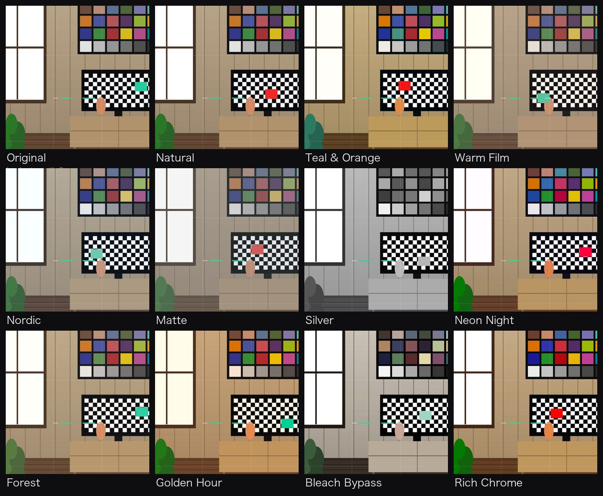

There are 11 built-in looks. Each look is a 33³ 3D LUT, baked on the CPU from a recipe and uploaded to the GPU. The image above shows the same scene with each look applied (all film effects at 0).

| Looks panel | Importing a .cube |
|:---:|:---:|
| 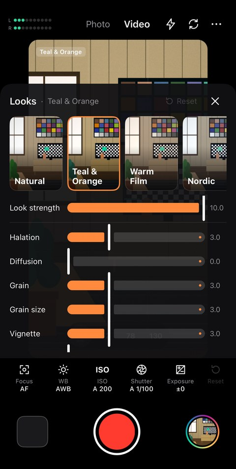 | 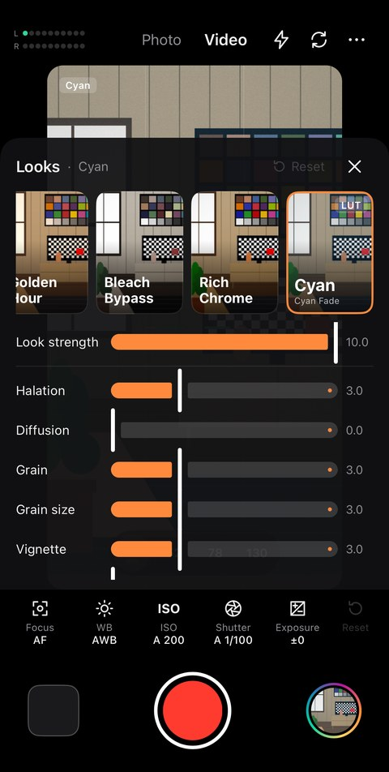 |

- Tap the looks button at the bottom right to open the panel. Every card is a thumbnail of that look applied to the **live** image.
- **Look strength**: continuously adjustable from 0 to 10; 0 means no look.
- **Import .cube**: the last card in the row; pick a file through the system Files browser. Supports 3D LUTs (`LUT_3D_SIZE` 2–256, optionally with `DOMAIN_MIN` / `DOMAIN_MAX`); 1D LUTs are not supported. An imported LUT takes a Rec.709 image as input; with log on, the log signal is converted back to Rec.709 first, so the same LUT looks the same in both modes. Imported cards carry a `LUT` badge in the top-right corner; the file is copied into the app's private storage (`Application Support/luts`) and loaded automatically on the next launch. If a file can't be parsed, the error message says why (for example, which line is malformed).
- **Reset** (in the panel's title bar): restores look strength and the film effects to their defaults without changing the selected look. Grayed out when everything is already at its default.

### Film effects

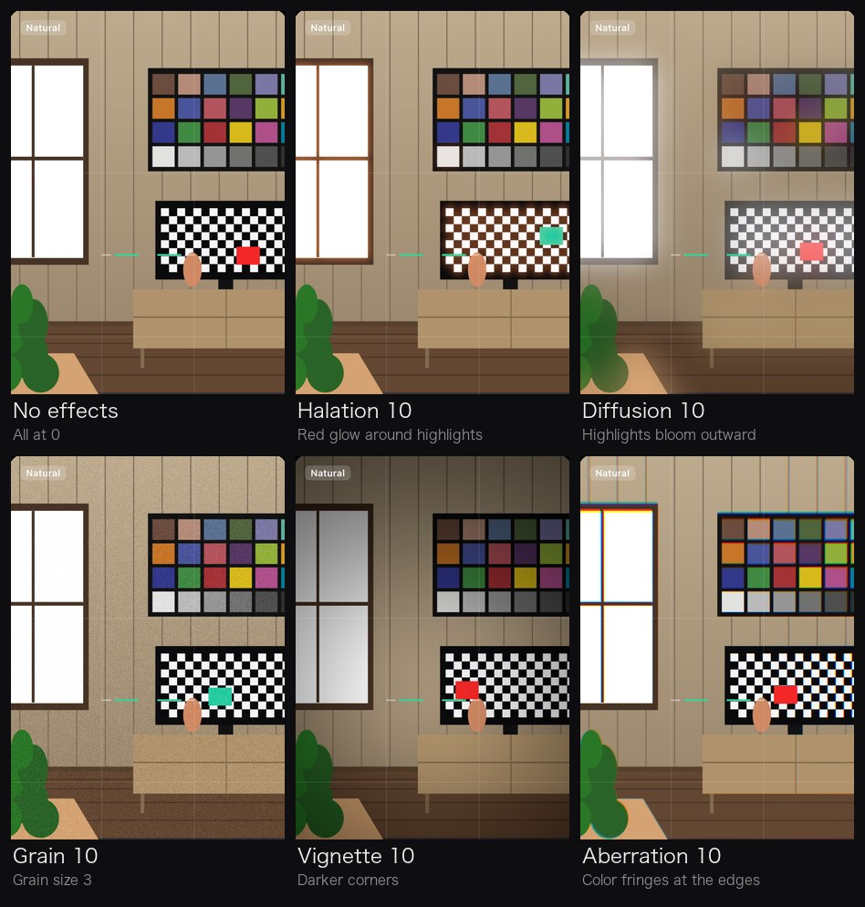

| Effect | What it does | Default |
|---|---|:---:|
| Halation | Film halation: bright areas (linear luminance > 0.8) spill a reddish glow outward | 3 |
| Diffusion | A diffusion filter: brighter areas (linear luminance > 0.4) bloom outward and contrast drops | 0 |
| Grain | Film grain that changes every frame | 3 |
| Grain size | The size of the grain | 3 |
| Vignette | Lens vignetting that falls off toward the edges following the cos⁴ law | 3 |
| Aberration | Lateral chromatic aberration: the red and blue channels drift further apart toward the edges | 0 |

- Every effect is a continuous value from 0 to 10, adjusted in the looks panel, applied in real time and baked into videos and photos.
- Halation and diffusion are computed in linear light (a Dual Kawase blur pyramid in half-float textures), so only bright enough areas glow.

### Log and LUT burn-in

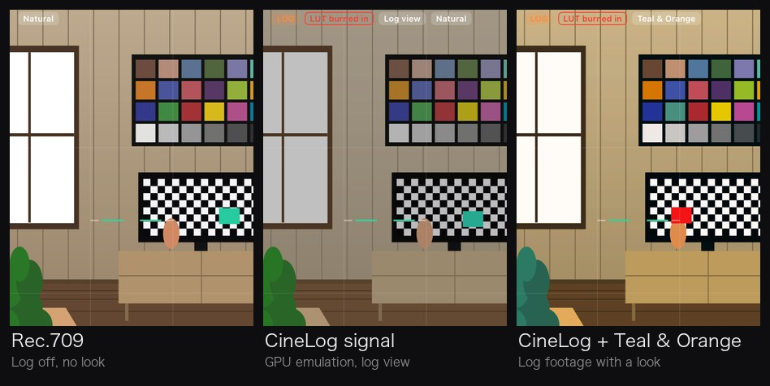

| Log monitoring (log view + waveform) | Settings: aspect ratio, frame rate, log |
|:---:|:---:|
| 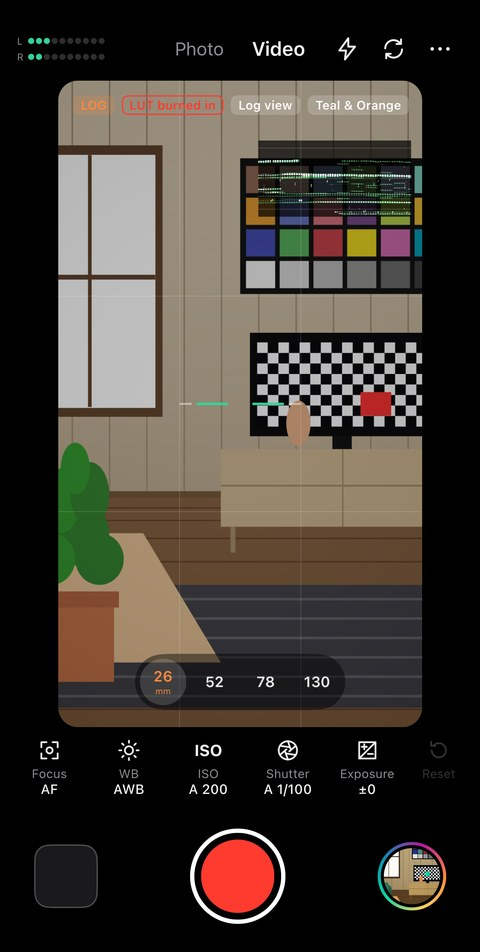 | 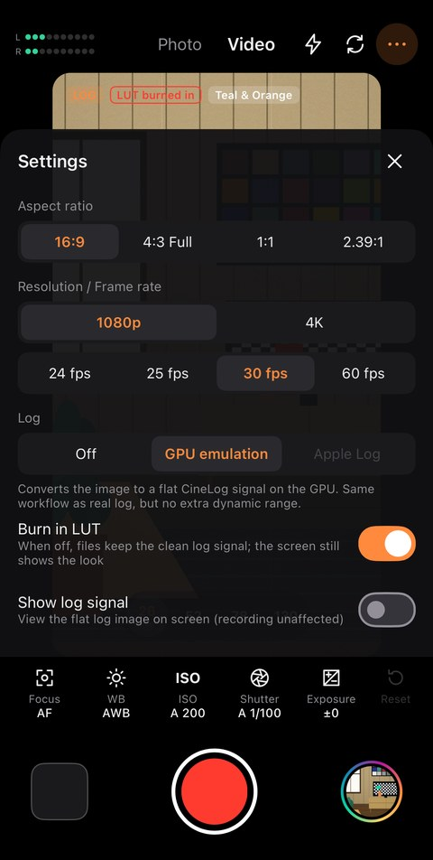 |

Choose under **Settings → Log**:

| Mode | How it works | Requirements |
|---|---|---|
| Off | The camera's Rec.709 image goes straight into the look | — |
| GPU emulation | The lens pass encodes the image as CineLog, and every look takes CineLog as input. Same workflow as real log, but no more dynamic range than the camera's own image | None |
| Apple Log | The camera outputs Apple Log directly (10-bit, Rec.2020 primaries); the lens pass decodes it to linear Rec.709 and re-encodes it as CineLog | iPhone 15 Pro or later with a format that supports Apple Log; grayed out otherwise |

The CineLog curve is `y = log2(1 + 63x) / log2(253)`: linear 0 → 0, 18% gray → 0.454, 1.0 → 0.752, 4.0 (+2 stops) → 1.0. Black stays at 0; the difference is mostly in the highlights, which is why the window turns visibly gray in the log image above.

With log on, two switches become available:

| Switch | Description |
|---|---|
| Burn in LUT | On by default: videos and photos are written with the look applied. Turn it off to write the clean log signal for grading later; the screen still shows the look. The status chip reads `LUT burned in` or `LUT monitor only` accordingly |
| Show log signal | Shows the flat log image on screen; the files are unaffected |

### Manual controls

| Manual ISO, shutter derived automatically | Manual white balance (temperature + tint) |
|:---:|:---:|
| 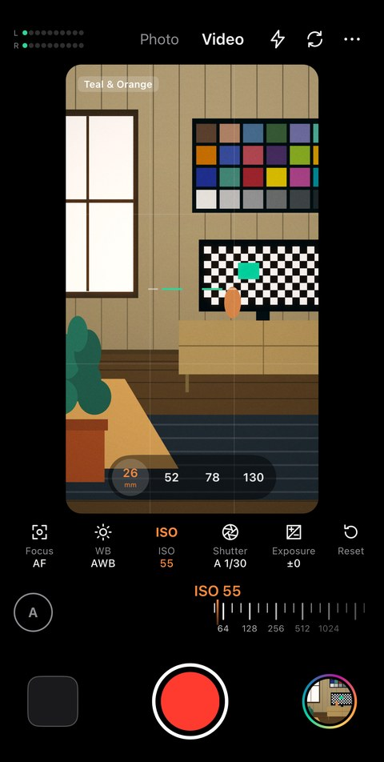 | 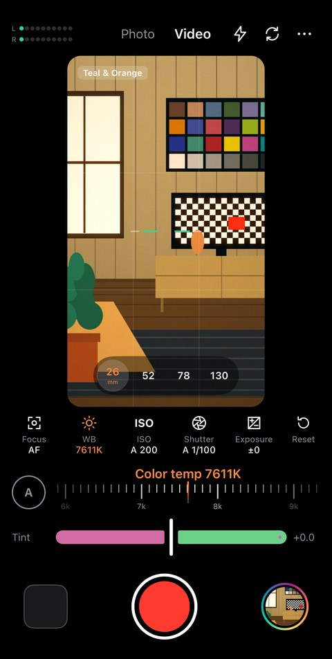 |

Tap a control in the toolbar to open its dial and drag the ticks left or right to change the value; the round button to the left of the dial returns to auto (for exposure compensation, it resets to zero).

| Control | Range | Notes |
|---|---|---|
| ISO | The range of the active format, in 1/3-stop steps | With only ISO locked, the shutter speed is derived from the meter |
| Shutter | The range of the active format, in 1/3-stop steps; no slower than one frame when recording and no slower than 1/15 s for photos | With only the shutter locked, ISO is derived; with both locked, exposure is fully manual |
| Exposure compensation | −3 to +3 EV in 1/3-stop steps (within the device's limits) | Applies to auto and semi-auto exposure |
| Focus | Infinity to the minimum focus distance | Requires a device that can lock the lens position |
| White balance | Temperature 2000–10000 K, tint −10 to +10 | Set in the ISP when the device supports custom white balance gains (the temperature is absolute); otherwise auto white balance is locked and the adjustment happens on the GPU |

Semi-auto exposure: while auto exposure runs, the app records the metered product `ISO × exposure time ÷ 2^EV`. When one of the two is locked, the other is that product divided by the locked value, clamped to the device's range.

### One-tap reset

| "Reset" lights up when a control is manual | Everything back on auto after a tap |
|:---:|:---:|
| 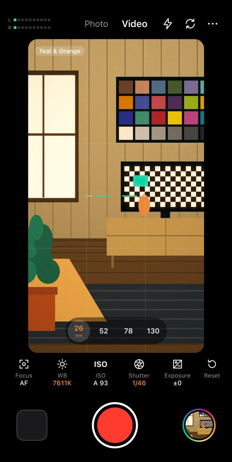 | 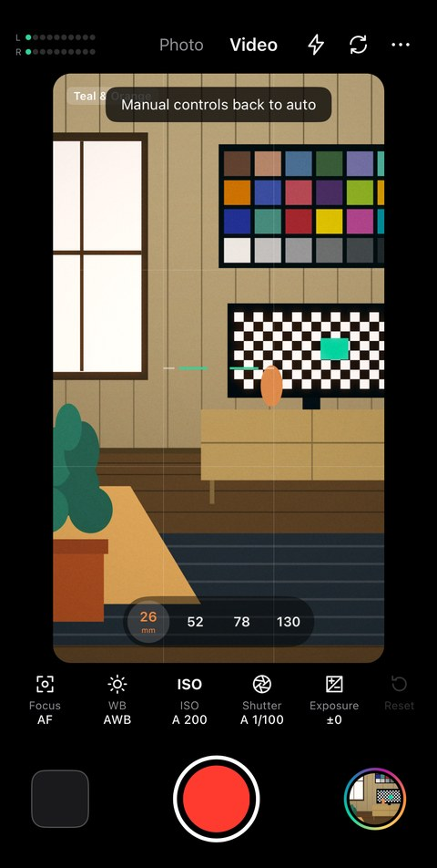 |

**Reset** at the right end of the toolbar:

- returns focus, white balance, ISO, shutter and exposure compensation to auto, restores the default temperature and tint, and cancels any focus / metering point set by tap-to-focus;
- leaves zoom, the torch and stabilization unchanged;
- is grayed out when everything is already on auto.

Resetting look strength and the film effects lives in the looks panel's title bar; see [Looks](#looks).

### Monitoring tools

| Zebra | Focus peaking | Waveform | Settings: monitoring |
|:---:|:---:|:---:|:---:|
| 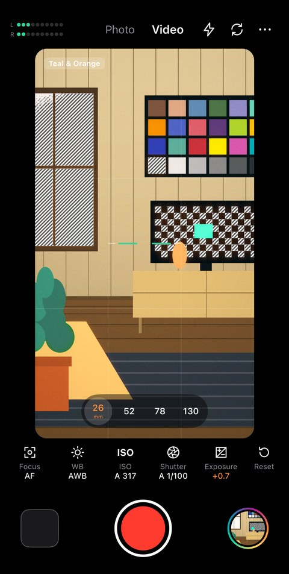 | 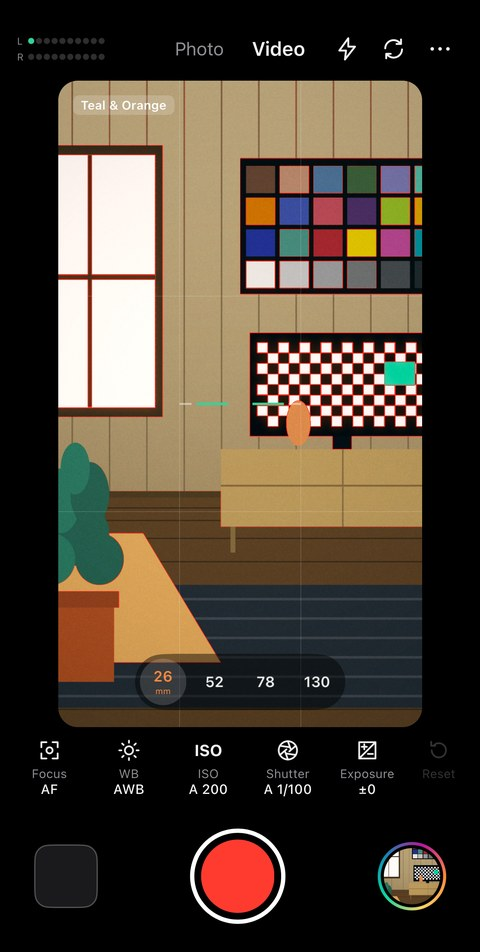 | 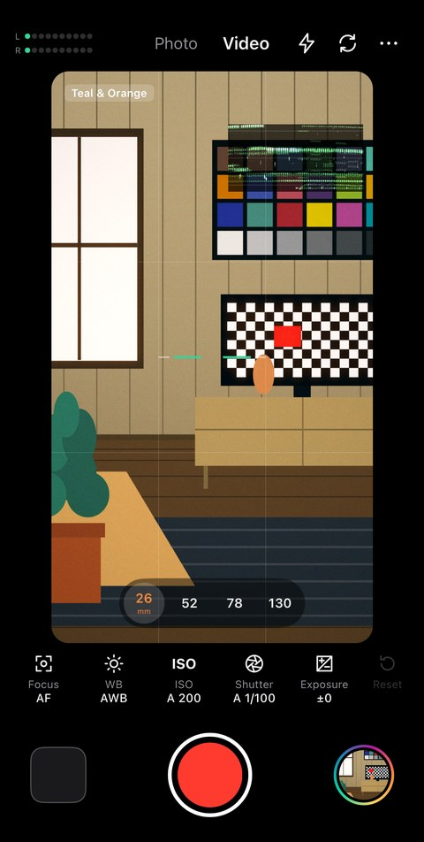 | 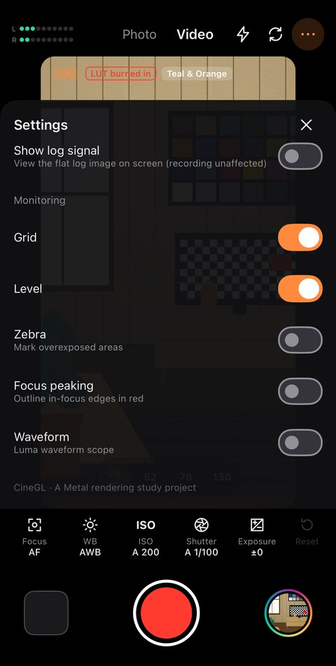 |

Toggle them under **Settings → Monitoring**. Monitoring tools are drawn on screen only and never end up in videos or photos.

| Tool | Description |
|---|---|
| Grid | Rule-of-thirds lines |
| Level | The center line always stays parallel to the horizon and turns green within 1° |
| Zebra | Diagonal stripes over areas at ≥ 95% luminance, warning of overexposure |
| Focus peaking | In-focus edges outlined in red |
| Waveform | A luma waveform in the top-right corner: horizontal position matches the frame, vertical is luminance |

### Aspect ratio, video and photos

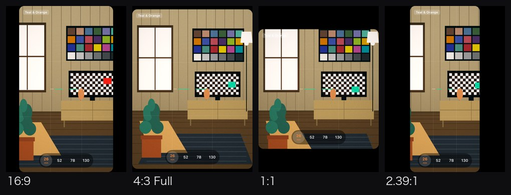

| Recording | Photo mode | Sample photo |
|:---:|:---:|:---:|
| 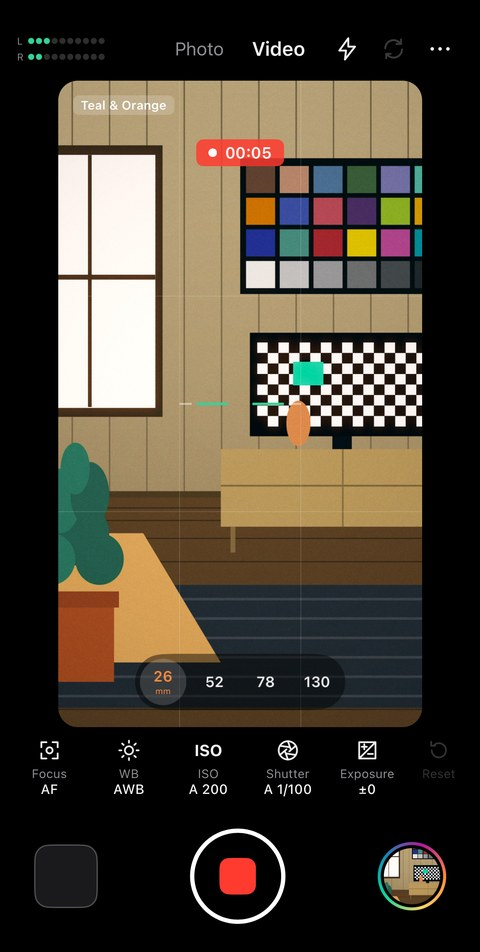 | 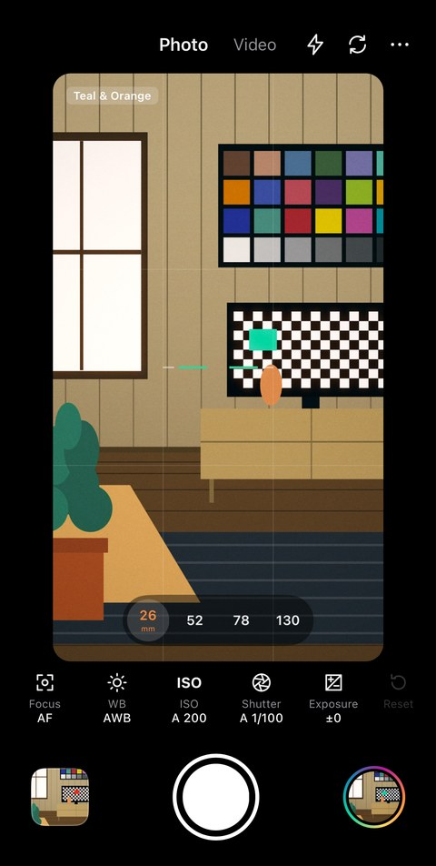 | 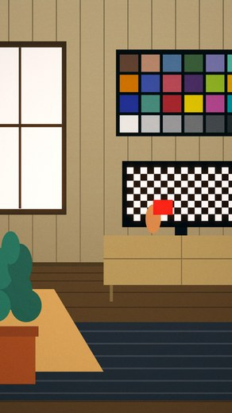 |

| Item | Details |
|---|---|
| Aspect ratio | 16:9, 4:3 full frame, 1:1 and 2.39:1, identical across preview, video and photos |
| Video | H.264 + AAC in MP4; 1080p / 4K at 24 / 25 / 30 / 60 fps, as supported by the device; audio and video share one clock (the host clock); the encoder buffer is always landscape, and portrait clips get rotation metadata |
| Photos | Captured as an uncompressed ~12 MP BGRA buffer at full 4:3, uploaded straight to the GPU and processed offscreen at full resolution, cropped to the chosen aspect ratio, rotated upright for the device orientation, with EXIF (ISO, shutter, focal length, aperture) |
| Front camera | Mirrored preview, unmirrored files |
| Other | Steady torch, stabilization (preview-optimized mode, where supported), remembered settings, screen stays on while framing |
| Saved to | The system photo library (only the "add photos" permission is requested; captures appear in Recents); the latest capture is also kept in the app's cache for the preview button at the bottom left |

## Build and run

Requirements:

- Xcode 16.2 (iOS 18.2 SDK)
- Device: an iPhone on iOS 17 or later (A12 or newer, with Metal); the Simulator works too, see below

```bash
open CineGL.xcodeproj
```

- **Device**: pick your development team under *Signing & Capabilities*, change the bundle ID (`com.mycro.cinegl.ios` by default) if needed, then Run. The first launch asks for camera and microphone access, and the first save asks for permission to add photos. Without microphone access, videos have no sound.
- **Simulator**: the Simulator has no camera and no reliable microphone input, so the app switches to a **virtual camera** (a room with a window, a color chart, a monitor, a plant and a lamp; the front camera shows a colorful scene) and a **virtual microphone** (room noise at about −45 dBFS). ISO, shutter, exposure compensation, focus, torch and zoom all change the virtual image for real, and recording, taking photos and saving to the library work exactly as on a device.

Command-line build:

```bash
export DEVELOPER_DIR=/Applications/Xcode.app/Contents/Developer
xcodebuild -project CineGL.xcodeproj -scheme CineGL -destination 'platform=iOS Simulator,name=iPhone 16' build
```

## Tests

| Command | Covers | Runs on |
|---|---|---|
| `xcodebuild test ... -only-testing:CineGLTests` | Unit tests: CineLog / Apple Log curves, color math, look baking, `.cube` parsing (including the error code for every failure), frame geometry, pass planning; the Metal engine actually running on the GPU (sensor orientation, front-camera unmirroring, a CineLog round trip that matches the CPU); the render queue (thumbnails, recording frames delivered in timestamp order); semi-auto exposure, one-tap reset, stream size selection, zoom presets, orientation snapping, tap-to-focus coordinates; the virtual camera; video file size and rotation metadata, photo EXIF; look names following the UI language, settings persistence; bilingual strings (both languages have the same keys and placeholders, and the code contains no hard-coded Chinese) | Simulator |
| `xcodebuild test ... -only-testing:CineGLUITests/CINUITests/testBasicFlow` | UI walkthrough: looks panel, manual ISO, one-tap reset, settings, recording, taking a photo | Simulator |
| See [About the screenshots](#about-the-screenshots) | README screenshots | Simulator |

`...` stands for `-project CineGL.xcodeproj -scheme CineGL -destination 'platform=iOS Simulator,name=iPhone 16'`. Xcode compiles the shaders into `default.metallib` at build time, so a shader syntax error fails the build.

## Architecture

```
┌────────────────────────── App (Objective-C) ──────────────────────────┐
│  UIKit UI ── CINCameraViewModel                                         │
│                  │              │               │              │        │
│        CINCameraController  CINRenderer   CINVideoRecorder  CINAudioCapture
│         (AVFoundation)    (render queue)   (AVAssetWriter)  (AVAudioEngine)
│      or CINSimulatedCamera      │  │ CVPixelBuffer ▲              │        │
│              │ CVPixelBuffer ──▶│  └───────────────┘   PCM ───────┘        │
│              ▼                  ▼                                        │
│  Render: CINEngine (Metal): lens → halation/diffusion → film → screen / video / photo
│  Core (C + simd): CINColor (CineLog / Apple Log) · CINLooks · CINLutBaker  │
│                   · CINCubeLut · CINFrameGeometry · CINPassPlan            │
└──────────────────────────────────────────────────────────────────────────┘
```

The order of work for one frame:

```
camera ─CVPixelBuffer (bi-planar YCbCr)─CVMetalTextureCache─▶ luma + chroma textures (zero copy)
   ─[lens input]────────▶ signal  (YCbCr → RGB, rotation and mirroring, aspect crop, aberration, white balance, vignette; CineLog when log is on)
   ─[halation/diffusion]▶ Dual Kawase blur pyramid (linear light, RGBA16F)
   ─[film]──────────────▶ graded  (add halation/diffusion → blend neutral and look LUTs → grain)
        ├─▶ screen (CAMetalLayer): rounded corners, peaking, zebra, waveform
        ├─▶ video: drawn rotated for the device orientation into the writer's pixel buffer; uses signal when burn-in is off
        └─▶ look thumbnails: one cell per look, read back as an atlas
```

For photos, the uncompressed BGRA buffer goes through the same pipeline as an RGBA texture, with a separate set of full-resolution textures.

## Project layout

| Path | Contents |
|---|---|
| `CineGL/Core/` | Pure CPU code: color math, look recipes, LUT baking, `.cube` parsing, frame geometry, pass planning |
| `CineGL/Render/` | Metal engine, render queue, LUT scheduling |
| `CineGL/Render/Shaders/` | MSL shaders and the parameter structs shared by Objective-C and Metal |
| `CineGL/Camera/` | AVFoundation camera, manual controls and camera math, tap-to-focus coordinates, the Simulator's virtual camera |
| `CineGL/Record/` | Microphone capture (with the Simulator's virtual microphone), video writing |
| `CineGL/Media/` | Saving to the photo library, EXIF, thumbnails |
| `CineGL/UI/` | Camera screen, view model, panels, preview overlays |
| `CineGL/UI/Components/` | Theme, icons, Material 3–style slider and switch, the dial and other controls |
| `CineGL/Localization/` | UI language selection and strings: English in `en.lproj`, Simplified Chinese in `zh-Hans.lproj` |
| `CineGLTests/`, `CineGLUITests/` | Unit tests, UI tests (including screenshots) |
| `tools/` | Scripts that generate the app icon and the README screenshot sheets |
| `docs/` | Design notes and screenshots (English UI screenshots in `docs/images/en/`) |

## Differences from the Android version

Features and UI are the same; these differences come from the platforms themselves:

| Item | Android | iOS |
|---|---|---|
| Rendering | OpenGL ES 3.0 (C++ core + JNI) | Metal (Objective-C + C/simd); GLSL rewritten as MSL |
| Camera input | `SurfaceTexture` external texture with a transform matrix from the system | `CVPixelBuffer` through the texture cache with zero copies; buffers stay in sensor orientation and the shaders rotate and mirror them |
| Third log mode | ISP tone curve (`TONEMAP_CURVE`) | Apple Log (straight from the camera, Rec.2020 primaries) |
| Manual white balance | An offset from AWB relative to 5500 K | An absolute temperature when custom gains are supported (starting from the current auto white balance temperature, so switching doesn't jump); otherwise the same as Android |
| Focus distance | Camera2 reports diopters | iOS only reports a lens position from 0 to 1, converted linearly to diopters using the minimum focus distance (approximate) |
| Exposure compensation | The device's steps | Continuous on iOS; the dial uses 1/3-stop steps within ±3 EV |
| Photos | JPEG, decoded and uploaded | Uncompressed BGRA requested directly, skipping an encode and a decode |
| Gallery button | Opens the system app | Opens the system preview (QuickLook) |
| Saved to | `DCIM/CineGL` | The photo library's Recents (only the add permission is requested, so no album can be created) |
| Emulator / Simulator | The emulator has virtual cameras | The app ships its own virtual camera and virtual microphone |

## About the screenshots

All screenshots here come from the iOS Simulator (iPhone 16) with the app in English ([the Chinese README](README.md) uses screenshots of the Chinese UI). A UI test takes them automatically, and a script crops, tiles and labels them:

```bash
export DEVELOPER_DIR=/Applications/Xcode.app/Contents/Developer
TEST_RUNNER_CIN_SHOT_DIR=/tmp/shots-en TEST_RUNNER_CIN_LANG=en TEST_RUNNER_CIN_SEED_LUT=<some .cube> \
  xcodebuild test -project CineGL.xcodeproj -scheme CineGL -destination 'platform=iOS Simulator,name=iPhone 16' \
  -only-testing:CineGLUITests/CINUITests/testScreenshots
python3 tools/make_readme_images.py /tmp/shots-en en docs/images/en --photo <the photo just taken, from the Simulator's library>
```

- The image comes from the app's built-in virtual camera: the back camera shows a room whose window and lamp are far brighter than white, to demonstrate overexposure, halation and zebra stripes; a square moves around on the monitor.
- The virtual camera supports every manual control; white balance takes the GPU fallback path (there is no ISP in the Simulator).
- The .cube import screenshot: the system file picker can't be driven by a UI test, so the Debug launch argument `-CINSeedLut` places a .cube in the import folder beforehand.

## Known limitations

- So far this has only been verified in the Simulator. These behaviors still need confirming on a device:
  - the orientation and mirroring of front-camera buffers (handled as "the native sensor orientation needs a 90° clockwise rotation");
  - Apple Log format selection and decoding;
  - the back multi-camera virtual device: it is only used when it supports both custom exposure and a locked lens position; otherwise the app falls back to the single wide camera (manual controls come first, at the cost of fewer zoom steps).
- The flash only works as a steady torch; there is no flash at the moment of capture.
- Live Photos are not implemented.
- The focus distance is approximated from the lens position, so the distances on the dial are not exact.
- Intermediate textures are BGRA8 (the halation pyramid is RGBA16F), so heavy grading may show banding.
- Video is H.264 only; photos are about 12 MP.
- Uploading to App Store Connect needs a newer Xcode / SDK; the local Xcode 16.2 is only for development and on-device debugging.

## Further reading

- [docs/design-notes.md](docs/design-notes.md): why each step works the way it does, the pitfalls hit on iOS and the approaches left out, plus exercises. The Chinese version is [docs/原理与设计取舍.md](docs/原理与设计取舍.md).
- The Android version's design notes (the same pipeline on OpenGL ES): `CineGL-Android/docs/design-notes.md`.
