# CineGL（iOS）

简体中文 | [English](README.en.md)

电影感相机 App，同时也是一个 **Metal 渲染滤镜** 的学习项目。相机画面经过一条完整的 GPU 管线（镜头 → 胶片曝光 → 冲洗调色 → 颗粒），实时预览、录像、拍照共用同一套渲染。

本仓库是 CineGL Android 版（独立仓库 `CineGL-Android`）的 iOS 实现，功能和界面与 Android 版一致。全部用 Objective-C 编写，纯数学部分（色彩、LUT 烘焙、几何）是 C 函数 + simd，可以直接单测；渲染从 OpenGL ES 3.0 换成了 iOS 上性能最好的 Metal，着色器逐个从 GLSL 改写为 MSL，pass 划分和参数完全对应。

- [界面一览](#界面一览)
- 功能：[影调](#影调) · [胶片效果](#胶片效果) · [Log 与 LUT 烧录](#log-与-lut-烧录) · [手动参数](#手动参数) · [一键重置](#一键重置) · [监看辅助](#监看辅助) · [画幅、录像与拍照](#画幅录像与拍照)
- 开发：[构建与运行](#构建与运行) · [测试](#测试) · [架构](#架构) · [目录结构](#目录结构)
- 其他：[与 Android 版的差异](#与-android-版的差异) · [截图说明](#截图说明) · [已知限制](#已知限制) · [进一步阅读](#进一步阅读)

## 界面一览

<p align="center">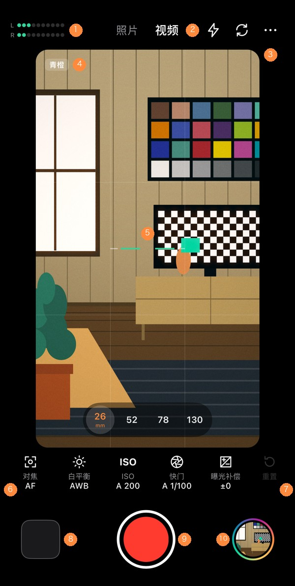</p>

| 序号 | 名称 | 说明 |
|:---:|---|---|
| 1 | 电平表 | 视频模式下显示麦克风左右声道电平 |
| 2 | 照片 / 视频 | 切换拍摄模式，录制中不可切换 |
| 3 | 前后摄 · 设置 | 切换前后摄像头；`···` 打开设置面板。设备有补光灯时左侧另有补光按钮 |
| 4 | 状态角标 | 当前影调；开启 Log 时另显示 `LOG`、`LUT 烧录` / `LUT 仅监看`、`Log 原片` |
| 5 | 网格与水平仪 | 三分线；水平仪中线与地平线保持平行，对齐时变绿 |
| 6 | 手动参数 | 对焦、白平衡、ISO、快门、曝光补偿。点击展开刻度盘，数值为橙色表示该项处于手动 |
| 7 | 一键重置 | 有手动参数时亮起，点击后全部恢复自动 |
| 8 | 相册 | 最近一次拍摄的缩略图，点击用系统预览打开 |
| 9 | 快门 | 照片模式下拍照；视频模式下开始 / 停止录制 |
| 10 | 影调 | 打开影调面板，按钮显示当前影调的实时缩略图 |

预览区手势：

| 手势 | 作用 |
|---|---|
| 单击 | 在该点对焦并测光 |
| 长按 | 取消点击对焦，恢复连续对焦 |
| 双指缩放 | 变焦。设备支持多档变焦时，画面底部显示 35mm 等效焦距按钮（如 26 / 52 / 78 mm） |

**界面语言**：跟随系统。系统首选语言为简体中文时显示中文，其他语言（包括繁体中文）一律显示英文。

> 截图来自 iOS 模拟器的虚拟相机，见[截图说明](#截图说明)。

## 功能

### 影调

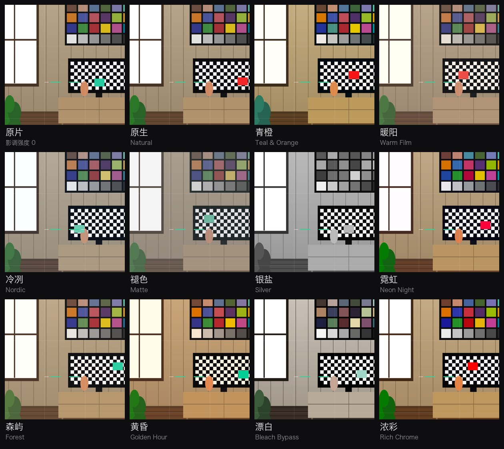

内置 11 个影调。每个影调是一张 33³ 的 3D LUT，由 CPU 按配方烘焙后上传 GPU。上图是同一场景分别套用各影调的效果（胶片效果均为 0）。

| 影调面板 | 导入 .cube |
|:---:|:---:|
| 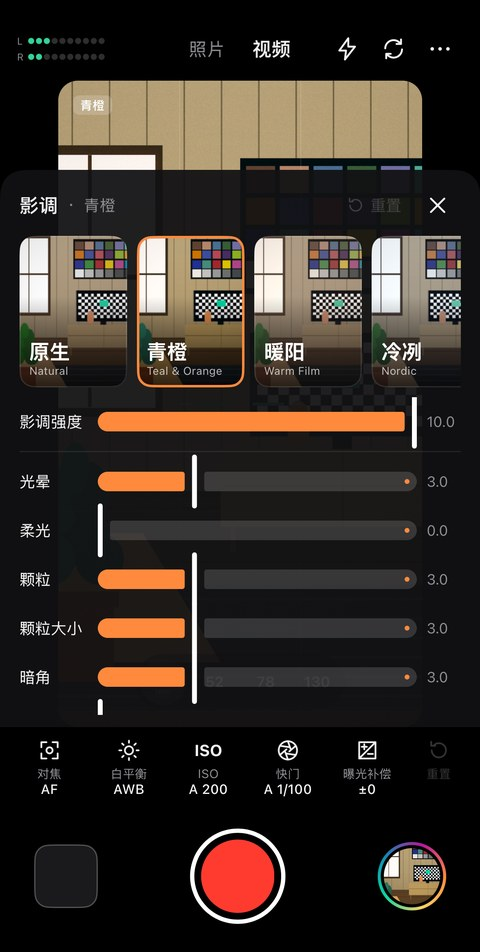 | 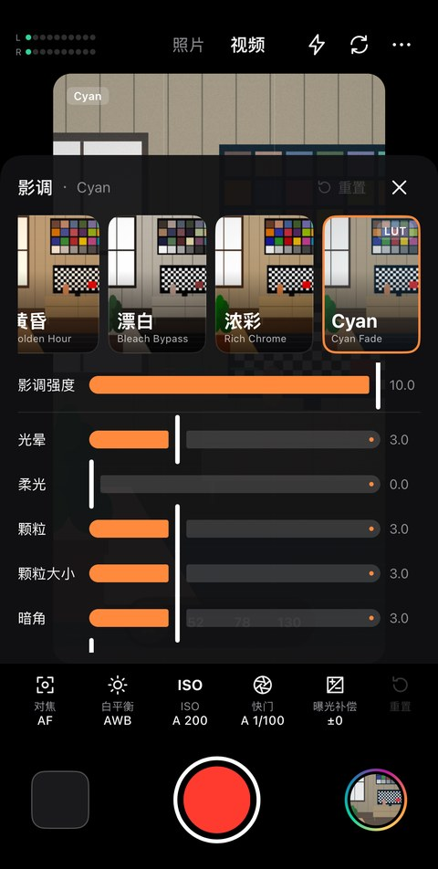 |

- 点击右下角的影调按钮打开面板。每张卡片都是该影调作用在**实时画面**上的缩略图。
- **影调强度**：0–10 连续可调，0 表示不套用影调。
- **导入 .cube**：位于卡片列表末尾，通过系统「文件」选择。支持 3D LUT（`LUT_3D_SIZE` 2–256，可带 `DOMAIN_MIN` / `DOMAIN_MAX`），不支持 1D LUT。导入的 LUT 以 Rec.709 画面为输入，开启 Log 时会先把 Log 转回 Rec.709 再套用，所以同一个 LUT 在两种模式下效果一致。导入后卡片右上角标 `LUT`，文件复制到 App 私有目录（`Application Support/luts`），下次启动自动加载。文件无法解析时，提示里会写明原因（例如第几行格式不对）。
- **重置**（面板标题栏）：影调强度与胶片效果恢复默认，所选影调不变。全部为默认值时置灰。

### 胶片效果

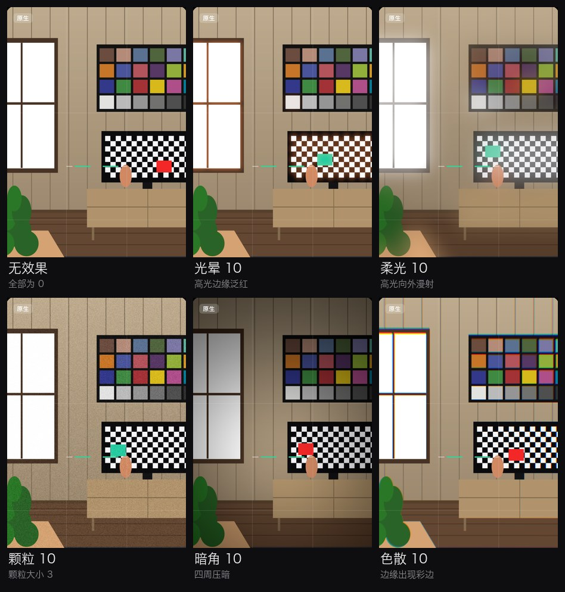

| 效果 | 作用 | 默认值 |
|---|---|:---:|
| 光晕 | 模拟胶片的 halation：亮部（线性亮度 > 0.8）向外泛出偏红的光 | 3 |
| 柔光 | 模拟柔光镜：较亮区域（线性亮度 > 0.4）向四周漫射，反差降低 | 0 |
| 颗粒 | 叠加随帧变化的胶片颗粒 | 3 |
| 颗粒大小 | 颗粒的尺寸 | 3 |
| 暗角 | 镜头暗角，按 cos⁴ 规律向四周衰减 | 3 |
| 色散 | 镜头横向色差：越靠近画面边缘，红、蓝通道错位越明显 | 0 |

- 所有效果都是 0–10 的连续值，在影调面板中调节，实时生效，录像和拍照都会带上。
- 光晕与柔光在线性空间中计算（Dual Kawase 模糊金字塔，半精度浮点纹理），只有足够亮的区域才会发光。

### Log 与 LUT 烧录

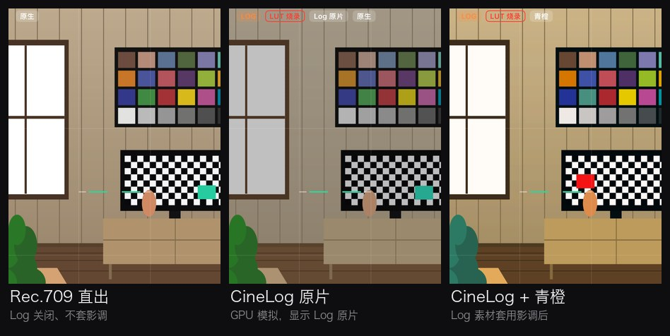

| Log 监看（Log 原片 + 波形图） | 设置：画幅、帧率、Log |
|:---:|:---:|
| 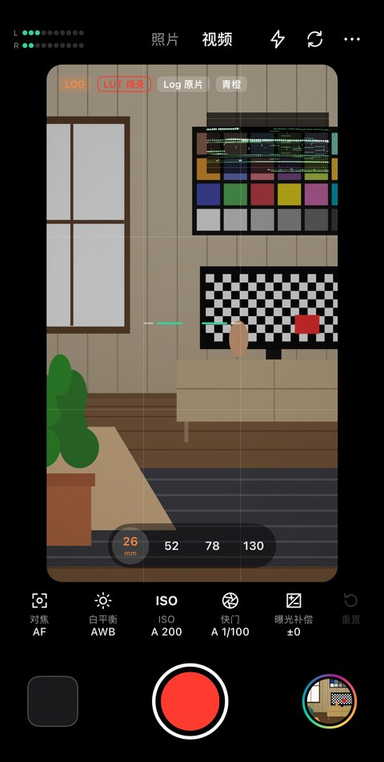 | 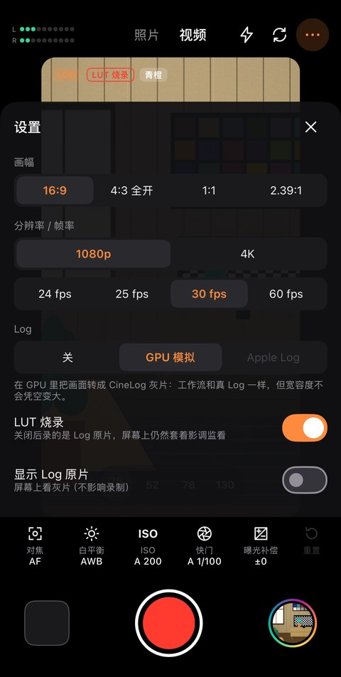 |

在 **设置 → Log** 中选择：

| 模式 | 原理 | 要求 |
|---|---|---|
| 关 | 相机直出的 Rec.709 画面直接进入影调 | — |
| GPU 模拟 | 在镜头 pass 中把画面编码为 CineLog，之后的影调都以 CineLog 为输入。工作流与真 Log 相同，但宽容度不会超过相机直出 | 无 |
| Apple Log | 相机直接输出 Apple Log（10 bit、Rec.2020 原色），镜头 pass 解码为线性 Rec.709 后再编码为 CineLog | iPhone 15 Pro 及以上、当前格式支持 Apple Log，否则该项置灰 |

CineLog 曲线为 `y = log2(1 + 63x) / log2(253)`：线性 0 → 0，18% 灰 → 0.454，1.0 → 0.752，4.0（+2 档）→ 1.0。黑位仍在 0，主要差别在高光，所以上图中窗户在 Log 原片里明显变灰。

开启 Log 后有两个开关：

| 开关 | 说明 |
|---|---|
| LUT 烧录 | 默认开启，录像和照片写入套用影调后的画面。关闭后写入 Log 原片，便于后期调色，屏幕上仍套用影调监看。角标随之显示 `LUT 烧录` 或 `LUT 仅监看` |
| 显示 Log 原片 | 屏幕上直接显示 Log 灰片，不影响写入文件的内容 |

### 手动参数

| 手动 ISO，快门自动推算 | 手动白平衡（色温 + 色调） |
|:---:|:---:|
| 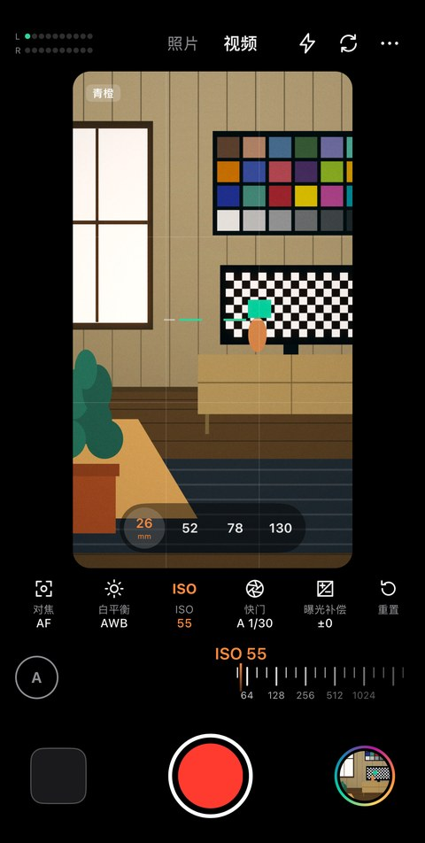 | 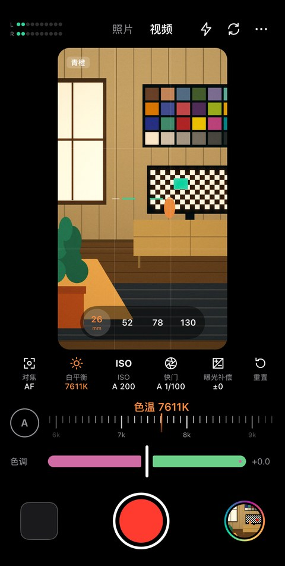 |

点击工具栏中的参数展开刻度盘，左右拖动刻度调值；刻度盘左侧的圆形按钮切回自动（曝光补偿为归零）。

| 参数 | 范围 | 说明 |
|---|---|---|
| ISO | 当前格式支持的范围，每格 1/3 档 | 只锁定 ISO 时，快门按测光结果自动推算 |
| 快门 | 当前格式支持的范围，每格 1/3 档；录像时不慢于一帧的时长，拍照时不慢于 1/15 s | 只锁定快门时，ISO 自动推算；两项都锁定为全手动 |
| 曝光补偿 | −3 – +3 EV，每格 1/3 档（不超过设备上限） | 在自动和半自动曝光下生效 |
| 对焦 | 无穷远到最近对焦距离 | 需要设备支持锁定镜头位置 |
| 白平衡 | 色温 2000–10000 K，色调 −10 – +10 | 设备支持自定义白平衡增益时在 ISP 中设定（色温为绝对值），否则锁定自动白平衡后在 GPU 中调整 |

半自动曝光：自动曝光时记录测光乘积 `ISO × 曝光时间 ÷ 2^EV`；锁定其中一项后，另一项由测光乘积除以锁定值得到，并限制在设备范围内。

### 一键重置

| 有手动参数时「重置」亮起 | 点击后全部恢复自动 |
|:---:|:---:|
| 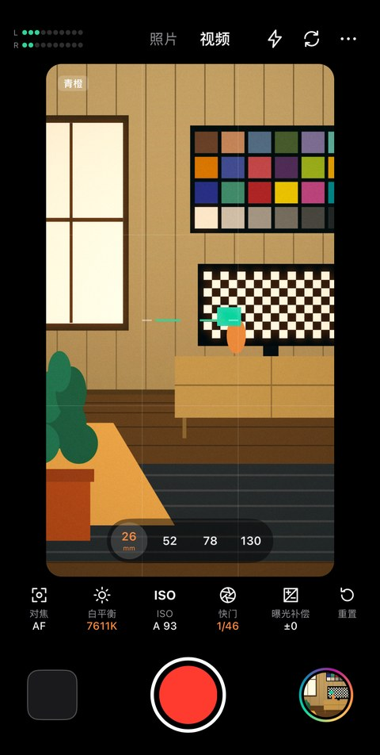 | 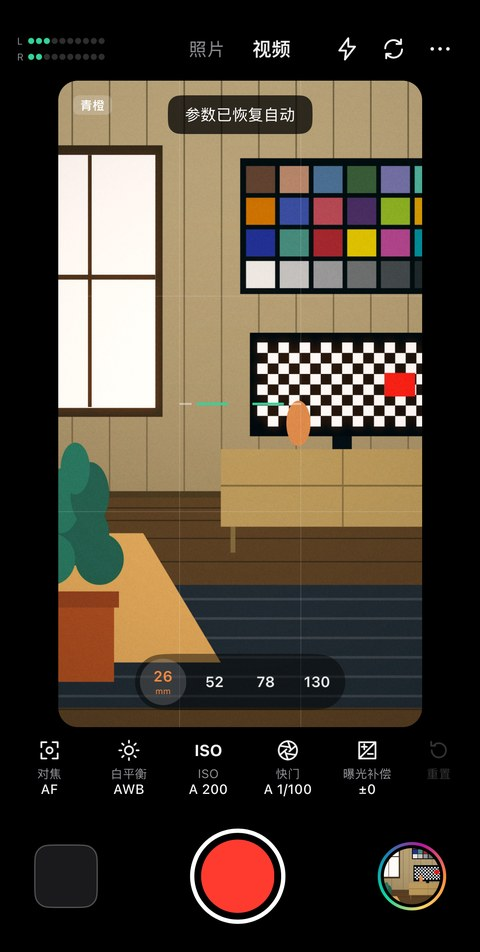 |

工具栏最右侧的 **重置**：

- 对焦、白平衡、ISO、快门、曝光补偿恢复为自动，色温和色调回到默认值，同时取消点击对焦锁定的对焦 / 测光点；
- 变焦、补光、防抖保持不变；
- 所有参数都处于自动时置灰。

影调强度与胶片效果的重置在影调面板标题栏，见[影调](#影调)。

### 监看辅助

| 斑马纹 | 峰值对焦 | 波形图 | 设置：辅助 |
|:---:|:---:|:---:|:---:|
| 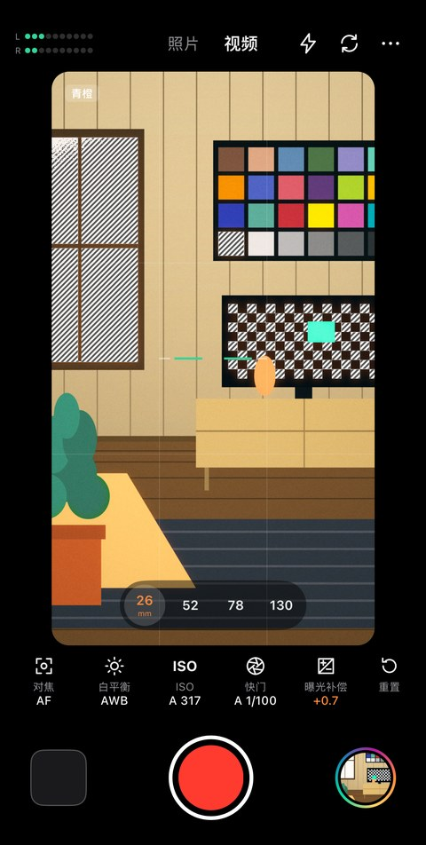 | 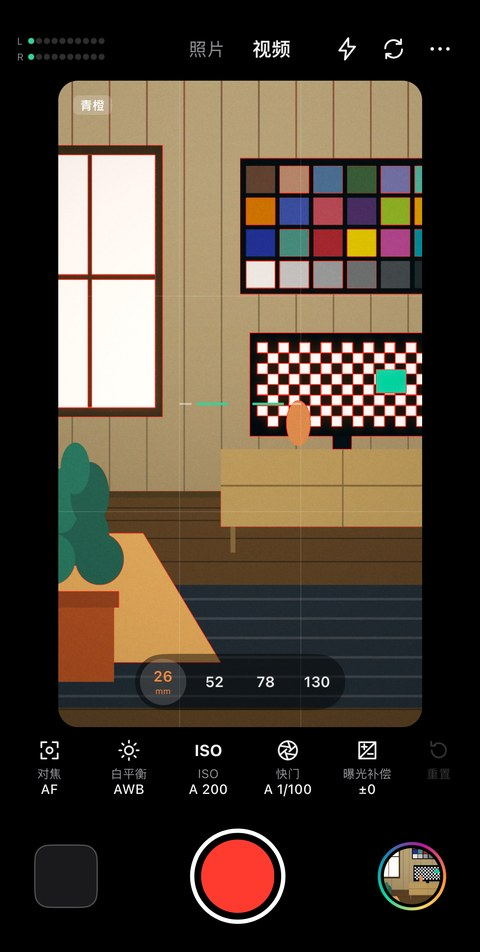 | 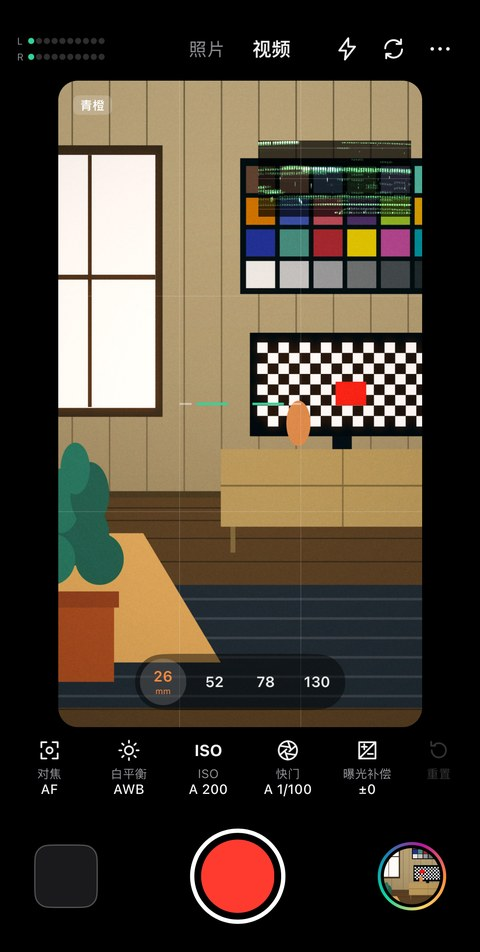 | 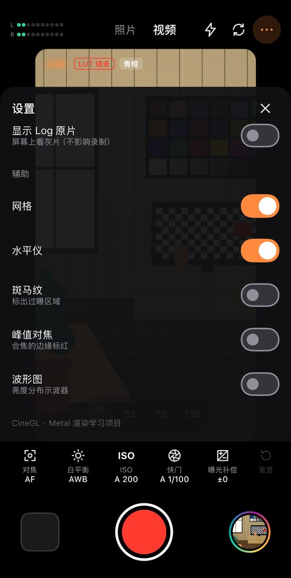 |

在 **设置 → 辅助** 中开关。监看辅助只画在屏幕上，不会进入录像和照片。

| 功能 | 说明 |
|---|---|
| 网格 | 三分线 |
| 水平仪 | 中线始终与地平线平行，偏差小于 1° 时变绿 |
| 斑马纹 | 用斜纹标出亮度 ≥ 95% 的区域，提示过曝 |
| 峰值对焦 | 合焦的边缘描红 |
| 波形图 | 右上角的亮度波形：横轴对应画面横向位置，纵轴为亮度 |

### 画幅、录像与拍照

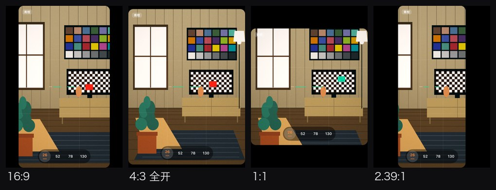

| 录制中 | 照片模式 | 成片示例 |
|:---:|:---:|:---:|
| 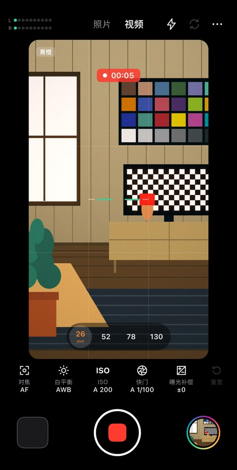 | 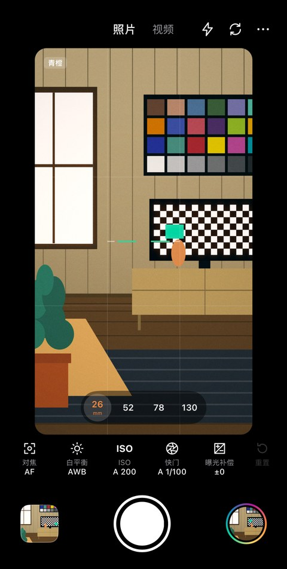 | 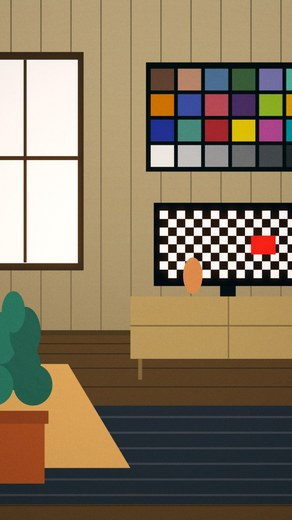 |

| 项目 | 说明 |
|---|---|
| 画幅 | 16:9、4:3 全开、1:1、2.39:1，预览、录像、拍照一致 |
| 录像 | H.264 + AAC，MP4；1080p / 4K，24 / 25 / 30 / 60 fps，按设备能力列出；音视频使用同一时钟（主机时钟）对齐；编码缓冲始终为横向，竖拍写入旋转元数据 |
| 拍照 | 以 4:3 全幅拍摄约 1200 万像素的未压缩 BGRA 缓冲，直接上传 GPU 按全分辨率离屏处理，按所选画幅裁切，按设备朝向转正，写入 EXIF（ISO、快门、焦距、光圈） |
| 前置摄像头 | 预览镜像，成片不镜像 |
| 其他 | 常亮补光、防抖（预览优化模式，设备支持时）、设置记忆、取景时屏幕常亮 |
| 保存位置 | 系统相册（只申请「添加照片」权限，出现在「最近项目」中）；另在 App 缓存里保留最近一次拍摄，供左下角预览 |

## 构建与运行

环境要求：

- Xcode 16.2（iOS 18.2 SDK）
- 设备：iOS 17 及以上的 iPhone（A12 起，支持 Metal）；模拟器也能运行，见下方说明

```bash
open CineGL.xcodeproj
```

- **真机**：在 *Signing & Capabilities* 中选择自己的开发团队，必要时把 Bundle ID（默认 `com.mycro.cinegl.ios`）改成自己的，然后 Run。首次启动会申请相机与麦克风权限，第一次保存时申请「添加照片」权限。未授予麦克风权限时，录像不带声音。
- **模拟器**：模拟器没有摄像头和稳定的麦克风输入，App 会自动换成**虚拟相机**（一个有窗户、色卡、显示器、绿植和台灯的房间；前置为彩色场景）和**虚拟麦克风**（约 −45 dBFS 的底噪）。ISO、快门、曝光补偿、对焦、补光、变焦都会真实地改变虚拟画面，录像、拍照、存相册的流程与真机相同。

命令行构建：

```bash
export DEVELOPER_DIR=/Applications/Xcode.app/Contents/Developer
xcodebuild -project CineGL.xcodeproj -scheme CineGL -destination 'platform=iOS Simulator,name=iPhone 16' build
```

## 测试

| 命令 | 内容 | 运行环境 |
|---|---|---|
| `xcodebuild test ... -only-testing:CineGLTests` | 单测：CineLog / Apple Log 曲线、色彩数学、影调烘焙、`.cube` 解析（含各类错误的错误码）、画面几何、pass 规划；Metal 引擎在 GPU 上真跑一遍（传感器方向转正、前置去镜像、CineLog 往返与 CPU 一致）；渲染队列（缩略图回传、录像帧按时间戳顺序交付）；半自动曝光、一键重置、流尺寸选择、变焦预设、朝向吸附、点击对焦坐标换算；虚拟相机；录像文件尺寸与旋转元数据、照片 EXIF；影调名随界面语言切换、设置读写；双语文案检查（中英文的键与占位符一致，代码里没有硬编码的中文） | 模拟器 |
| `xcodebuild test ... -only-testing:CineGLUITests/CINUITests/testBasicFlow` | UI 走查：影调面板、手动 ISO、一键重置、设置、录像、拍照 | 模拟器 |
| 见[截图说明](#截图说明) | README 截图 | 模拟器 |

`...` 为 `-project CineGL.xcodeproj -scheme CineGL -destination 'platform=iOS Simulator,name=iPhone 16'`。着色器在编译期由 Xcode 编成 `default.metallib`，语法错误会直接让构建失败。

## 架构

```
┌────────────────────────── App（Objective-C）──────────────────────────┐
│  UIKit 界面 ── CINCameraViewModel                                      │
│                  │              │               │              │       │
│        CINCameraController  CINRenderer   CINVideoRecorder  CINAudioCapture
│         (AVFoundation)     (渲染队列)     (AVAssetWriter)  (AVAudioEngine)
│       或 CINSimulatedCamera     │  │ CVPixelBuffer ▲              │       │
│              │ CVPixelBuffer ──▶│  └───────────────┘   PCM ───────┘       │
│              ▼                  ▼                                       │
│  Render：CINEngine（Metal）：镜头 → 光晕/柔光 → 胶片 → 上屏 / 录像 / 拍照   │
│  Core（C + simd）：CINColor（CineLog / Apple Log）· CINLooks · CINLutBaker │
│                    · CINCubeLut · CINFrameGeometry · CINPassPlan          │
└─────────────────────────────────────────────────────────────────────────┘
```

一帧的处理顺序：

```
相机 ─CVPixelBuffer（YCbCr 双平面）─CVMetalTextureCache─▶ 亮度 + 色度纹理（零拷贝）
   ─[镜头 input]──────▶ signal  （YCbCr → RGB、转正与镜像、画幅裁切、色散、白平衡、暗角；开 Log 时编码为 CineLog）
   ─[光晕/柔光 glow]──▶ Dual Kawase 模糊金字塔（线性空间、RGBA16F）
   ─[胶片 film]───────▶ graded  （叠加光晕/柔光 → 中性 LUT 与影调 LUT 混合 → 颗粒）
        ├─▶ 屏幕（CAMetalLayer）：圆角、峰值、斑马纹、波形图
        ├─▶ 录像：按设备朝向旋转画进写入器的像素缓冲；LUT 烧录关闭时改用 signal
        └─▶ 影调缩略图：每个影调一格，拼成图集读回
```

拍照时，未压缩的 BGRA 缓冲作为 RGBA 纹理走同一条管线，使用独立的一套全分辨率纹理。

## 目录结构

| 路径 | 说明 |
|---|---|
| `CineGL/Core/` | 纯 CPU：色彩数学、影调配方、LUT 烘焙、`.cube` 解析、画面几何、pass 规划 |
| `CineGL/Render/` | Metal 引擎、渲染队列、LUT 调度 |
| `CineGL/Render/Shaders/` | MSL 着色器与 OC / Metal 共用的参数结构体 |
| `CineGL/Camera/` | AVFoundation 相机、手动参数与相机数学、点击对焦坐标换算、模拟器虚拟相机 |
| `CineGL/Record/` | 麦克风采集（含模拟器虚拟麦克风）、录像写入 |
| `CineGL/Media/` | 写入系统相册、EXIF、缩略图 |
| `CineGL/UI/` | 相机页、ViewModel、面板、预览叠加层 |
| `CineGL/UI/Components/` | 主题、图标、Material 3 风格的滑杆与开关、刻度盘等控件 |
| `CineGL/Localization/` | 界面语言判断与文案：英文在 `en.lproj`，简体中文在 `zh-Hans.lproj` |
| `CineGLTests/`、`CineGLUITests/` | 单测、UI 测试（含截图） |
| `tools/` | 生成 App 图标、README 截图拼图的脚本 |
| `docs/` | 原理与设计取舍、截图（英文界面截图在 `docs/images/en/`） |

## 与 Android 版的差异

功能和界面一致；以下差异来自平台本身：

| 项目 | Android 版 | iOS 版 |
|---|---|---|
| 渲染 | OpenGL ES 3.0（C++ 核心 + JNI） | Metal（OC + C/simd），GLSL 改写为 MSL |
| 相机输入 | `SurfaceTexture` 外部纹理，变换矩阵由系统给出 | `CVPixelBuffer` 经纹理缓存零拷贝，缓冲保持传感器方向，转正与镜像在着色器里做 |
| Log 第三档 | ISP 色调曲线（`TONEMAP_CURVE`） | Apple Log（相机直出，Rec.2020 原色） |
| 手动白平衡 | 相对 AWB 的 5500K 偏移 | 支持自定义增益时为绝对色温（从自动白平衡的当前色温起步，切换不跳）；否则同 Android |
| 对焦距离 | Camera2 给出屈光度 | iOS 只给镜头位置 0–1，按最近对焦距离线性换算成屈光度（近似） |
| 曝光补偿 | 设备档位 | iOS 为连续值，按 1/3 档、±3 EV 给刻度盘 |
| 拍照 | JPEG 解码后上传 | 直接要未压缩 BGRA，省一次编解码 |
| 相册按钮 | 用系统应用打开 | 用系统预览（QuickLook）打开 |
| 保存位置 | `DCIM/CineGL` | 系统相册「最近项目」（只申请添加权限，无法建相册） |
| 模拟器 | 模拟器自带虚拟摄像头 | App 内置虚拟相机与虚拟麦克风 |

## 截图说明

本文截图均来自 iOS 模拟器（iPhone 16），App 语言为简体中文（[英文版 README](README.en.md) 使用英文界面的截图）。截图由 UI 测试自动拍摄，再由脚本裁切、拼图、标号：

```bash
export DEVELOPER_DIR=/Applications/Xcode.app/Contents/Developer
TEST_RUNNER_CIN_SHOT_DIR=/tmp/shots-zh TEST_RUNNER_CIN_LANG=zh-Hans TEST_RUNNER_CIN_SEED_LUT=<某个 .cube> \
  xcodebuild test -project CineGL.xcodeproj -scheme CineGL -destination 'platform=iOS Simulator,name=iPhone 16' \
  -only-testing:CineGLUITests/CINUITests/testScreenshots
python3 tools/make_readme_images.py /tmp/shots-zh zh docs/images --photo <模拟器相册里刚拍的照片>
```

- 画面来自 App 内置的虚拟相机：后置是一个房间场景，窗户和台灯的亮度远超白色，用来演示过曝、光晕和斑马纹；显示器里有一个会动的方块。
- 虚拟相机支持全部手动参数，白平衡走 GPU 兜底那条路（模拟器上没有 ISP）。
- 导入 .cube 的截图：系统文件选择器无法由 UI 测试操作，改用 Debug 启动参数 `-CINSeedLut` 预先放入一个 .cube。

## 已知限制

- 目前只在模拟器上验证过，以下行为需要真机确认：
  - 前置摄像头的缓冲方向与镜像（按「传感器原生方向需顺时针转 90°」处理）；
  - Apple Log 的格式选择与解码；
  - 后置多摄虚拟设备：只有同时支持自定义曝光和锁定镜头位置时才使用，否则退回单个广角镜头（手动参数优先，变焦档位会少）。
- 闪光灯只提供常亮补光，没有拍照瞬间闪光。
- 未实现动态照片（实况）。
- 对焦距离是由镜头位置近似换算的，刻度上的米数不精确。
- 管线中间纹理为 BGRA8（光晕金字塔为 RGBA16F），大幅度调色时可能出现色带。
- 录像仅支持 H.264；拍照约 1200 万像素。
- 上传 App Store Connect 需要更新的 Xcode / SDK，本机 Xcode 16.2 只能用于开发和真机调试。

## 进一步阅读

- [docs/原理与设计取舍.md](docs/原理与设计取舍.md)：每一步为什么这样做、iOS 上踩过的坑和放弃的方案，附练习题。英文版见 [docs/design-notes.md](docs/design-notes.md)。
- Android 版的原理与设计取舍（OpenGL ES 版的同一条管线）：`CineGL-Android/docs/原理与设计取舍.md`。
